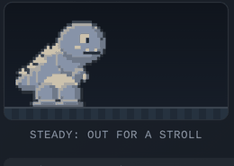
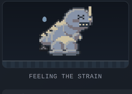
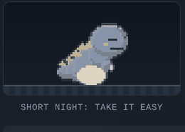
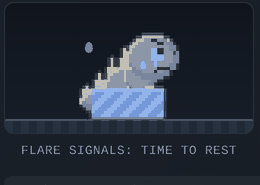
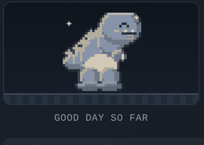
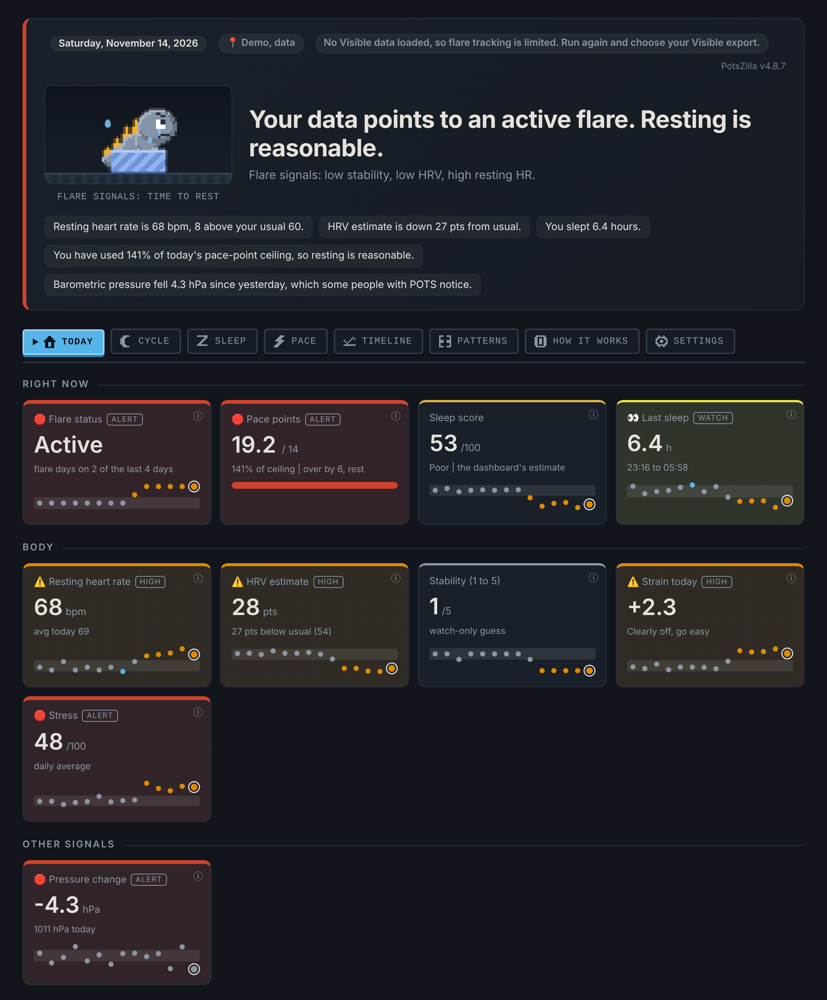
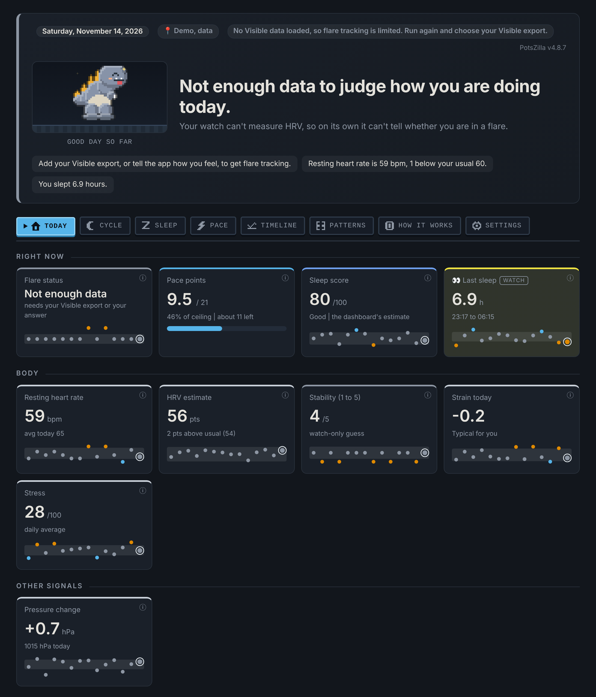
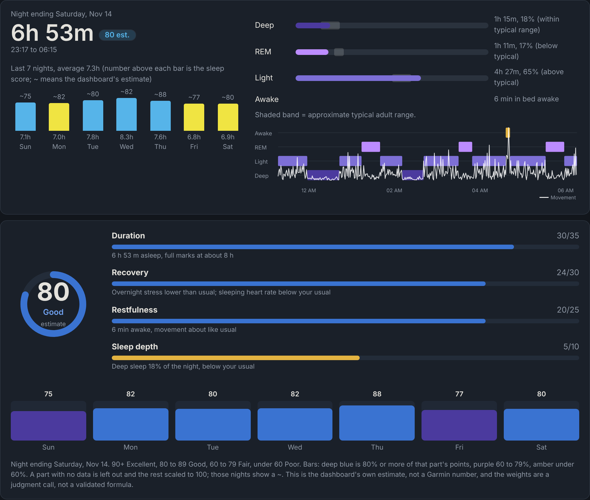
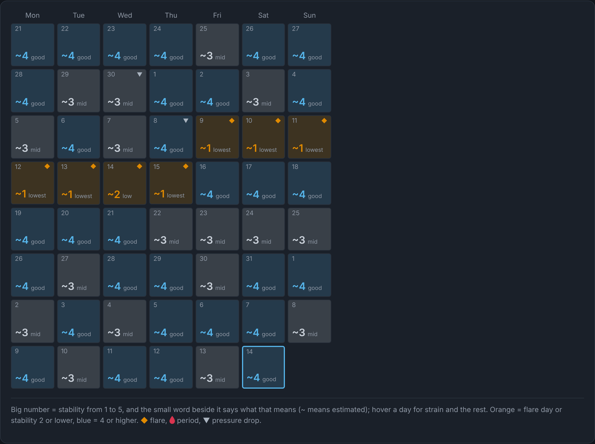
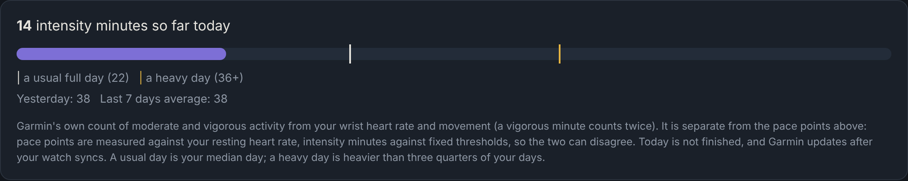

# PotsZilla
The mascot reacts to your day:

| Steady | Strained | Short night | Flare | Good day |
|---|---|---|---|---|
|  |  |  |  |  |

A personal health dashboard that turns your Garmin watch data (and, optionally, a Visible export) into a plain-language picture of how your body is doing, tracks and rates flares, and tells you when to take it easy. It is a single Python script that opens a small window to log in, then builds one self-contained, dark-themed HTML page and opens it in your browser. A pixel-art Derpy dinosaur mascot in the banner reacts to your day.

## Screenshots

All pictures use made-up demo data.

| A flare day | A good day |
|---|---|
|  |  |







**Version 4.8.7** (see [CHANGELOG.md](CHANGELOG.md))

**Who it might help:** people managing chronic illness who need to pace their energy, such as ME/CFS, POTS, lupus, or other autoimmune conditions that can benefit from self-monitoring biometric data. It shows when your body is under strain and when to rest. It is not specific to any one condition.

> **Not medical advice.** PotsZilla compares you with your own recent normal. It is not a diagnosis, and nothing in it replaces your doctor.

## What it does

- **Today:** a flare status card first, then pace points, sleep, resting heart rate, overnight HRV, stability and strain. Cards that need attention get an emoji, a WATCH / HIGH / ALERT tag and a thicker border, so the level never depends on colour alone. Each card shows the last 14 days against your own usual range.
- **Flare detection:** your own 60-day, flare-resistant baseline for HRV, resting heart rate, stress and sleep, with a stability score from 1 to 5 (calibrated to your Visible history when you have one) and active-flare and nap detection.
- **Sleep:** Garmin's sleep stages with a movement overlay, plus a dashboard-estimated sleep score (duration, overnight stress and recovery, restfulness, depth), since older watches report no score.
- **Pace:** a daily pace-point budget with a "REST!" verdict, and a gauge of the intensity minutes you actually used.
- **Cycle (optional):** phase, wheel, flare-by-phase patterns and period markers. It can be switched off entirely, and every cycle-related file can be deleted from Settings.
- **Timeline, Patterns and How it works:** shared-axis charts, what seems linked to what, a flare-prediction backtest, and the reasoning behind every number.
- **Accessibility:** a colourblind-safe palette, slow animation (nothing flashes faster than about 2 to 3 changes per second), and a Settings switch to turn the mascot animation off.

## Download

* **[Download POTSzilla_dashboard_4.8.7.pyw](https://raw.githubusercontent.com/axlekitty/POTSzilla/main/POTSzilla_dashboard_4.8.7.pyw)** *(Right-click and choose **Save link as...**)*
* **[Download requirements.txt](https://raw.githubusercontent.com/axlekitty/POTSzilla/main/requirements.txt)** *(Right-click and choose **Save link as...**)*
* **[Download the full repository (.zip)](https://github.com/axlekitty/POTSzilla/archive/refs/heads/main.zip)** *(One-click download of all files)*

## Installation

PotsZilla is one Python script. It was built and tested on Windows; Mac and Linux should work but are untested.

**1. Install Python (3.10 or newer)**
- **Windows:** download it from [python.org/downloads](https://www.python.org/downloads/). In the installer, tick **"Add python.exe to PATH"** on the first screen, then choose Install Now. This also installs Tk, which the app windows need.
- **Mac:** install from python.org (it includes Tk). The Homebrew version needs `brew install python-tk` as well.
- **Linux (Debian/Ubuntu):** `sudo apt install python3 python3-pip python3-tk`

Check it worked by opening a terminal (Command Prompt or PowerShell on Windows) and running `python --version` (on Mac/Linux, `python3 --version`).

**2. Install the modules**
The script needs four packages: `pandas`, `numpy`, `plotly` and `garminconnect`. Everything else it uses ships with Python. In a terminal, in the folder with the script:

```
pip install -r requirements.txt
```

or install them directly:

```
pip install pandas numpy plotly garminconnect
```

(On Mac/Linux use `pip3`. If `pip` is not found on Windows, try `python -m pip install ...`.)

**3. Run it**
Put `POTSzilla_dashboard_4.8.7.pyw` in a folder of its own, then double-click it (Windows) or run `python POTSzilla_dashboard_4.8.7.pyw` (`python3` on Mac/Linux). Log in to Garmin, or choose "Use saved data", and add a Visible export CSV when asked. The dashboard opens in your browser.

If a window does not appear, check `garmin_error_log.txt` in the same folder; the app writes its errors there.

Everything the app saves (login tokens, cached Garmin data, settings, the dashboard page) goes into a `garmin_cache/` folder next to the script. A `symptoms.csv` in the same folder is optional and lets you log your own columns.

## Your data stays on your computer

The script makes only these network calls: Garmin Connect (the login and data you ask for), [Open-Meteo](https://open-meteo.com) for barometric pressure and [Zippopotam.us](https://zippopotam.us) to turn a ZIP code into coordinates. Plotly's JavaScript is loaded in the generated page. There is no account, server or analytics of its own.

**Never commit your data.** The included `.gitignore` excludes the cache folder, exports, symptom logs and the generated page. Only the script is meant to be shared.

## Known limits

- It uses the unofficial `garminconnect` library, so Garmin login can fail (HTTP 401) or break when Garmin changes things. The app can fall back to saved data.
- The sleep-score weights are a judgment call, not a validated formula.
- Tuned and tested on a Forerunner 735XT. Other devices report different fields.
-

## How the numbers are made

The ideas behind PotsZilla come from published research. Where a study supports a signal, such as heart-rate variability falling around flares, or symptoms shifting across the menstrual cycle, the app's "How it works" tab names the source. But the formulas that turn those ideas into numbers (the stability score, flare detection, pace points, the estimated sleep score and their weights) are my own. I tried to be as scientific as I could, comparing you against your own recent baseline and borrowing from how other trackers do similar things, but in the end I'm making educated guesses. None of them have been clinically validated or tested against a medical standard. Treat every score as a rough guide to how you're doing compared with your own usual, not as a measurement. If you know the research better than I do and see something that should change, please open an issue.
